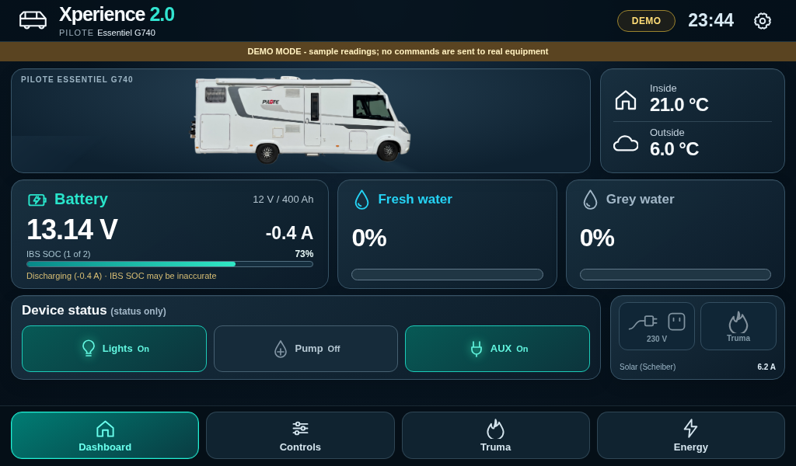

# Pilote Xperience 2.0 — unofficial web interface

A responsive, single-file web dashboard for selected **Pilote / Scheiber Xperience** motorhome systems. Built for an older in-vehicle Android tablet and for phones or desktop browsers.

> **Independent hobby project.** Not affiliated with, endorsed by, or supported by Pilote, Scheiber, or Truma. The application is experimental and should never be relied upon as the sole means of controlling safety-critical equipment.

## Screenshot



*Dashboard at 1024 × 600. Demo values only; no physical controls are operated.*

## Current status

**Prototype / use at your own risk.** The interface has been tested with one specific Scheiber installation. Device availability, field names, control semantics and firmware behavior may differ across motorhomes.

The repository includes:

- `index.html` — the standalone application, with embedded styling, JavaScript and vehicle artwork (no build process required).

## Features

- Live Scheiber data over a WebSocket connection (typically port `9474`).
- Dashboard for battery voltage, current and IBS-reported SOC, fresh/grey water levels, temperature and device states.
- Visual indicators for 230 V shore power, solar charging and Truma heating where available.
- Lights, water pump and AUX switches with **explicit control unlocking** and state confirmation from Scheiber.
- Demo mode for exploring the interface without sending physical control commands.
- Responsive layout for desktop, phones and approximately 1024 × 600 in-vehicle displays.
- Browser-local connection and dimming preferences.
- ES5-oriented JavaScript for compatibility with older Android WebView engines.

### Important control limitations

- Only individually unlocked **Scheiber `Dc` ON/OFF** operations for lights, pump and AUX are implemented in live mode.
- The UI waits for reported state confirmation and does **not** retry control commands automatically.
- **Truma controls and master shut-off remain disabled in live mode.** Their controls in demo mode are simulations.
- The app does not modify Scheiber EMB configuration.
- An open WebSocket is **not** proof that all CAN-connected modules are online.

## Getting started

1. Download `index.html`, or clone the repository.
2. Serve the HTML file from a **trusted local HTTP server**; the application makes WebSocket requests directly from the browser.
3. Open the page and select **Settings → Scheiber connection**.
4. Enter your own Scheiber tablet/bridge host address (the default `192.168.1.100` is a placeholder), or a full `ws://` / `wss://` URL.
5. Choose **Connect (live mode)** to receive real readings. Start in **Demo mode** if you only want to explore the interface.

### Option A: Your Wi-Fi router (if SSH and web hosting are available)

If your Wi-Fi router supports SSH/SCP **and** serves static HTML files, you can host the app there. The document root and login name vary by router; check its documentation first.

For an OpenWrt-based router using the default `uhttpd` document root, for example:

```sh
# Run on your computer; replace the example router address.
scp -O index.html root@192.168.1.1:/www/xperience2.html
```

Open `http://192.168.1.1/xperience2.html` in a browser connected to that Wi-Fi network. Other router models use different paths or may not support hosting files at all. SSH by itself is not enough: an HTTP server must also be enabled.

### Option B: From your phone (no router SSH required)

1. Download `index.html` to your phone.
2. For a quick look, open it in a browser or file viewer that accepts local HTML files; **Demo mode** may work this way.
3. For a reliable live connection, serve the file over HTTP from a trusted device or a local HTTP-server app on your phone, and open its local URL in the phone's browser.
4. Connect your phone to a network that can reach the Scheiber WebSocket host; enter its address under **Settings → Scheiber connection**.

A local `file://` page may be restricted from connecting to WebSockets on some mobile browsers. Phone-based hosting does not bypass Wi-Fi guest isolation, VPN routing rules, or browser mixed-content protections.

**Note:** The addresses above are examples only. Loading the web page does not guarantee that the browser can reach the Scheiber WebSocket endpoint. If the tablet is on another network, check routing and firewall rules; grant access only to the required destination and port.

## Networking and security

- **Do not expose the Scheiber WebSocket or the control page directly to the public Internet.**
- This static HTML app does **not** provide authentication or authorization. Anyone who can reach the page *and* connect to the WebSocket could potentially operate supported outputs after unlocking controls.
- Prefer a trusted LAN, appropriately restricted VPN/Tailscale access, and narrowly scoped firewall rules.
- A page loaded over `https://` may not be permitted to open a plain `ws://` connection because of browser mixed-content restrictions. Use a suitable secure WebSocket proxy if HTTPS access is needed.
- Browser-local connection settings are stored in `localStorage`. Do not enter secrets into connection URLs.
- Public contributions should never include private IP topology, tokens, credentials, GPS coordinates, or identifying vehicle details.

## Data interpretation

| Data | Notes |
| --- | --- |
| Battery voltage/current | Reported by the available Scheiber battery object. |
| IBS SOC | Displayed as *raw IBS-reported SOC*, **not** independently calculated capacity. If the installation has parallel batteries and IBS measures only one, SOC can be misleading. |
| Fresh/grey tanks | Uses reported `Tank` values, typically `EP_1` and `EU_1`. |
| Shore power | Reads `Presence_230V` when available. No reading is not the same as OFF. |
| Heating | Visual status and setpoint depend on the actual `Heating` object. |
| Outputs | `Eclairage`, `PompeAEau` and `Auxiliaire` are the implemented mappings. |

## Compatibility and troubleshooting

- Original target: an old Android 4.4.x in-vehicle tablet; current desktop and mobile browsers may behave differently.
- If the UI shows **OFFLINE**, check the WebSocket URL, tablet reachability, firewall rules and browser console.
- If the browser loads the page but cannot reach the Scheiber WebSocket, remember that the WebSocket connection originates from the **browser device**, not from the server hosting `index.html`.
- Control buttons remain disabled until a live connection provides supported, valid device state and the user explicitly unlocks controls.
- A stale or unavailable reading must not be interpreted as an OFF or zero value.

## Contributions

Issues and pull requests are welcome, especially for cross-device compatibility, accessibility, translations, and protocol documentation based on non-sensitive samples.

## License

No open-source license has been selected yet. Public visibility alone does not grant permission to reuse or redistribute the code beyond applicable default copyright rules. A license can be added later by the repository owner.
